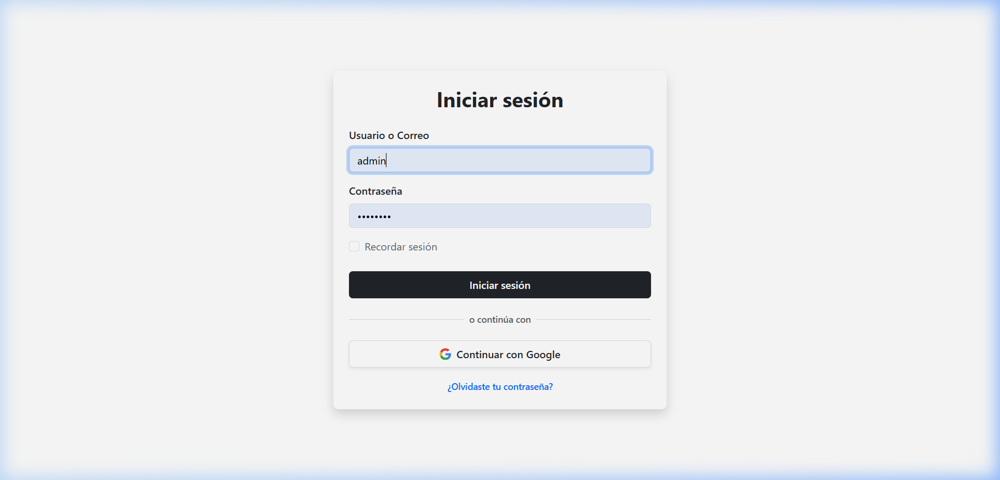
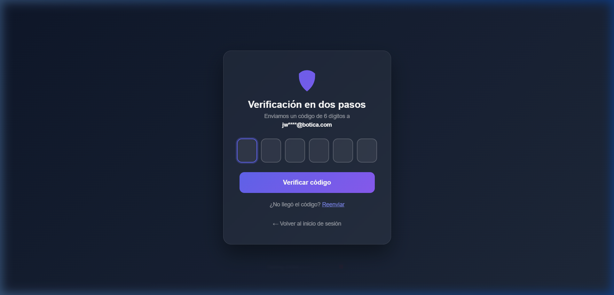
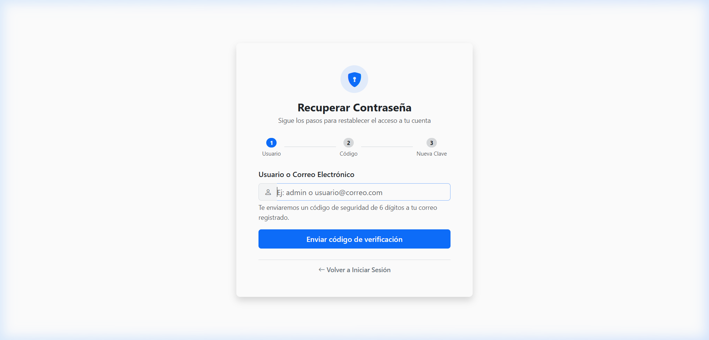
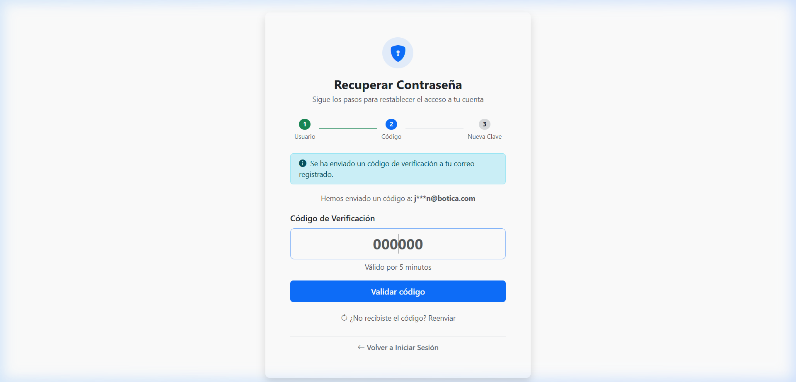
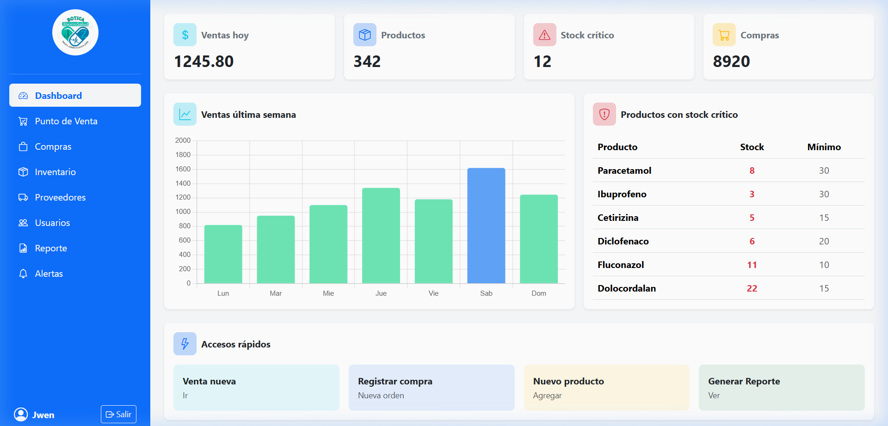
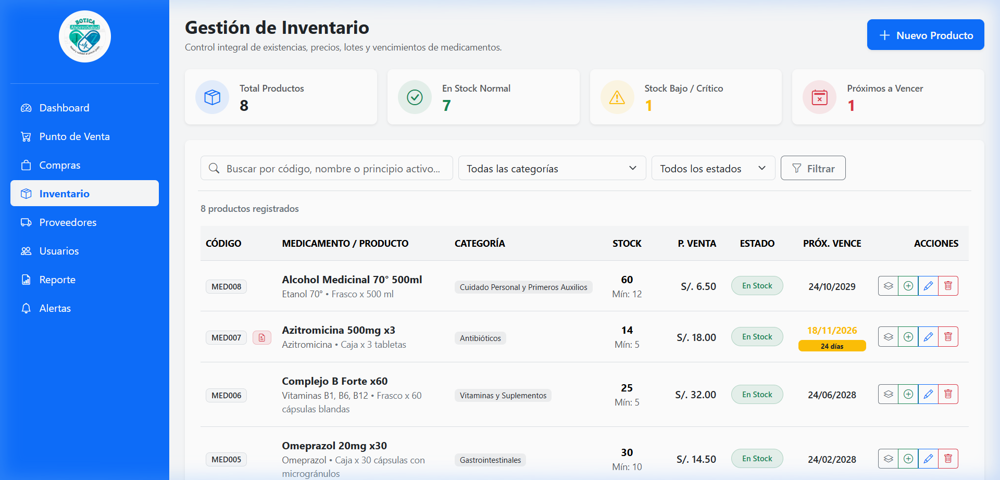
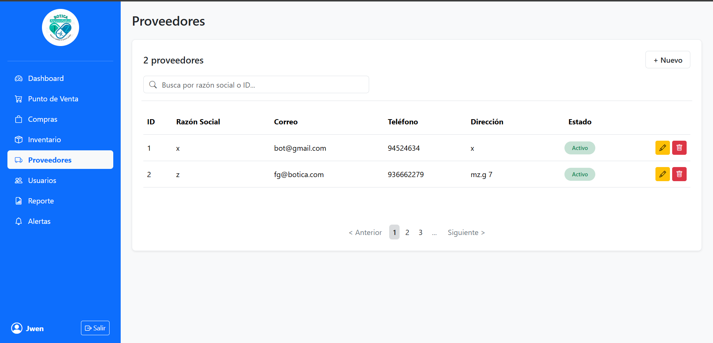
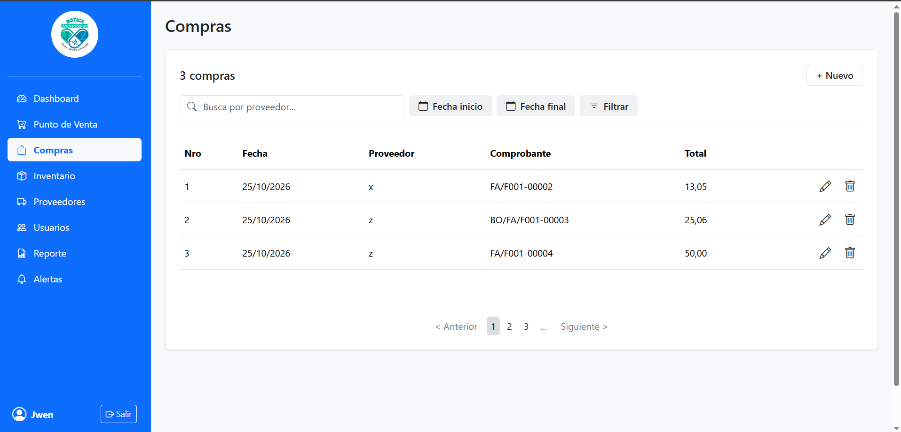
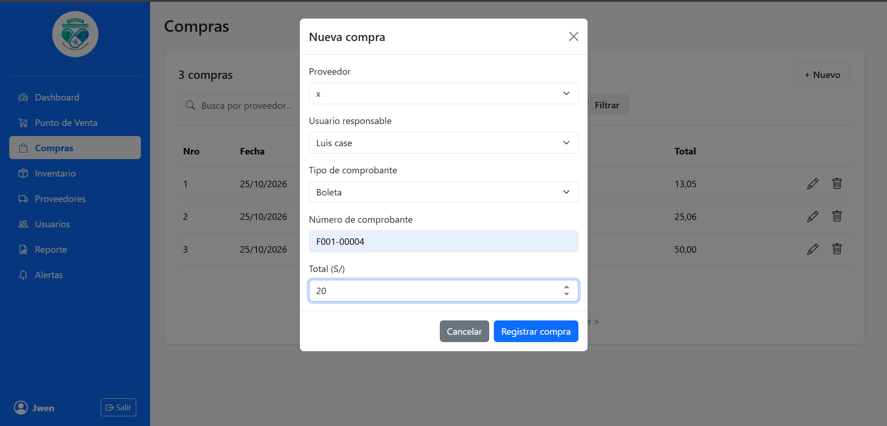
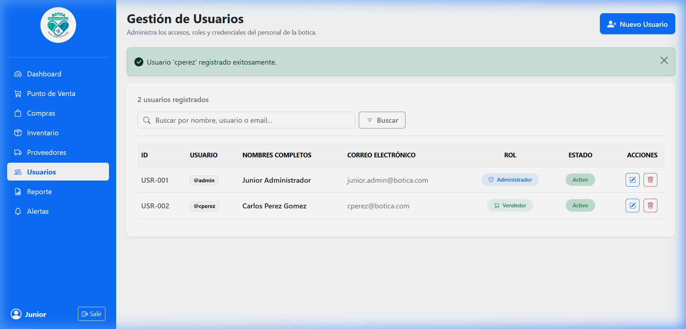

# 📖 Manual de Usuario — Sistema Web de Gestión de Botica "Ahorro y Salud"

**Versión:** 1.0.0  
**Fecha:** Octubre 2026  
**Entregable:** Documentación de Usuario Final  

---

## 📑 Tabla de Contenidos

1. [Introducción y Objetivos](#1-introducción-y-objetivos)
2. [Roles y Permisos de Acceso](#2-roles-y-permisos-de-acceso)
3. [Módulo de Inicio de Sesión y Seguridad](#3-módulo-de-inicio-de-sesión-y-seguridad)
   - [3.1 Inicio de Sesión (Usuario o Correo)](#31-inicio-de-sesión-usuario-o-correo)
   - [3.2 Opción "Recordar Sesión"](#32-opción-recordar-sesión)
   - [3.3 Inicio de Sesión con Google](#33-inicio-de-sesión-con-google)
   - [3.4 Doble Factor de Autenticación (2FA / OTP)](#34-doble-factor-de-autenticación-2fa--otp)
   - [3.5 Recuperación de Contraseña Olvidada (3 pasos)](#35-recuperación-de-contraseña-olvidada-3-pasos)
4. [Módulo de Dashboard e Indicadores Clave](#4-módulo-de-dashboard-e-indicadores-clave)
5. [Módulo de Inventario y Control de Lotes](#5-módulo-de-inventario-y-control-de-lotes)
   - [5.1 Semáforo de Stock (Normal, Bajo, Agotado)](#51-semáforo-de-stock-normal-bajo-agotado)
   - [5.2 Registro de Nuevos Productos](#52-registro-de-nuevos-productos)
   - [5.3 Gestión de Lotes y Vencimientos](#53-gestión-de-lotes-y-vencimientos)
6. [Módulo de Directorio de Proveedores](#6-módulo-de-directorio-de-proveedores)
7. [Módulo de Gestión de Compras](#7-módulo-de-gestión-de-compras)
   - [7.1 Registro de Nueva Orden de Compra](#71-registro-de-nueva-orden-de-compra)
   - [7.2 Búsqueda, Filtro por Fechas y Anulación](#72-búsqueda-filtro-por-fechas-y-anulación)
8. [Módulo de Administración de Usuarios y Roles](#8-módulo-de-administración-de-usuarios-y-roles)
9. [Preguntas Frecuentes y Recomendaciones de Seguridad](#9-preguntas-frecuentes-y-recomendaciones-de-seguridad)

---

## 1. Introducción y Objetivos

El **Sistema de Botica "Ahorro y Salud"** es una plataforma web desarrollada para sistematizar las operaciones cotidianas del establecimiento farmacéutico:
* Control estricto de existencias y medicamentos próximos a vencer (control por lotes).
* Registro y seguimiento de compras realizadas a laboratorios y distribuidores autorizados.
* Mantenimiento de información de proveedores con validación de RUC.
* Acceso protegido con roles y mecanismos de seguridad modernos (2FA y recuperación por correo).

---

## 2. Roles y Permisos de Acceso

El acceso al sistema está segmentado para salvaguardar la información:

| Rol | Descripción de Funciones | Acceso Permitido |
| :--- | :--- | :--- |
| **ADMINISTRADOR** | Control absoluto: usuarios, configuración, compras, inventario y reportes. | Todas las opciones del menú |
| **ALMACENERO** | Ingreso de lotes, control de caducidades, alertas de stock mínimo y órdenes de compra. | Inventario, Lotes, Compras, Proveedores, Alertas |
| **VENDEDOR / CAJERO** | Consulta de stock en mostrador y registro de transacciones de venta. | Punto de Venta (POS) y Consulta de Inventario |

---

## 3. Módulo de Inicio de Sesión y Seguridad

### 3.1 Inicio de Sesión (Usuario o Correo)
Para entrar a la aplicación, abra su navegador web y diríjase a:  
`http://localhost:8080/login`

1. En el campo **"Usuario o Correo"**, escriba su nombre de usuario (ej. `admin`) o su correo electrónico registrado (ej. `jwen.admin@botica.com`).
2. En el campo **"Contraseña"**, coloque su clave secreta.
3. Haga clic en el botón **"Iniciar sesión"**.

### 3.2 Opción "Recordar Sesión"
Si marca la casilla **"Recordar sesión"**, no tendrá que escribir sus datos durante los siguientes **7 días**, aun si cierra y vuelve a abrir el navegador.

### 3.3 Inicio de Sesión con Google
Puede usar su cuenta de Google haciendo clic en **"Continuar con Google"**. El sistema validará su correo y le dará acceso con el rol que tenga asignado.

---

### 3.4 Doble Factor de Autenticación (2FA / OTP)
Si el establecimiento tiene activada la protección 2FA, tras colocar usuario y clave aparecerá la siguiente pantalla:

1. Revise su bandeja de correo electrónico institucional o personal.
2. Busque el mensaje con el asunto: **"Código de verificación — Botica Ahorro y Salud"**.
3. Ingrese el código de **6 dígitos** en la pantalla.
4. Presione **"Verificar"**. Dispone de **5 minutos** antes de que el código caduque.

---

### 3.5 Recuperación de Contraseña Olvidada (3 pasos)
Si no recuerda su contraseña, presione el enlace **"¿Olvidaste tu contraseña?"** en la parte inferior del login.

#### Paso 1: Identificación
Coloque su usuario o correo y presione **"Enviar código de verificación"**:

#### Paso 2: Código de Seguridad
Ingrese el código de 6 dígitos que llegó a su correo electrónico:

#### Paso 3: Nueva Contraseña
Escriba su nueva contraseña (mínimo 6 caracteres), confírmela en el segundo casillero y presione **"Guardar nueva contraseña"**. El sistema confirmará el cambio y le permitirá ingresar de inmediato.

---

## 4. Módulo de Dashboard e Indicadores Clave

Pantalla principal para la supervisión gerencial y operativa:

* **Ventas hoy:** Ingresos monetarios acumulados en la jornada.
* **Productos:** Cantidad de ítems registrados en el catálogo.
* **Stock crítico:** Cantidad de medicamentos con existencia baja o agotada.
* **Compras:** Monto acumulado en adquisiciones de mercadería.
* **Menú Lateral Izquierdo:** Permite desplazarse fácilmente entre todos los módulos. Al finalizar su turno, presione el botón **"Salir"** en la esquina inferior.

---

## 5. Módulo de Inventario y Control de Lotes

Acceso: Menú lateral ➔ **"Inventario"**

### 5.1 Semáforo de Stock (Normal, Bajo, Agotado)
Para evitar desabastecimientos, el sistema clasifica automáticamente cada producto:
* 🟢 **Normal (Insignia Verde):** Stock por encima del mínimo de seguridad.
* 🟡 **Bajo (Insignia Amarilla):** Stock menor o igual al mínimo. Requiere reposición.
* 🔴 **Agotado (Insignia Roja):** Existencia cero (0).

### 5.2 Registro de Nuevos Productos
1. Presione el botón **"+ Nuevo Producto"**.
2. Indique el nombre comercial, principio activo, categoría (ej. Analgésicos, Antibióticos), precio de compra, precio de venta y stock mínimo recomendado.
3. Guarde el registro para incorporarlo al catálogo.

### 5.3 Gestión de Lotes y Vencimientos
Los medicamentos ingresan por lotes de fabricación:
1. En la fila del producto, haga clic en el botón de **"Lotes"** (icono de paquete/caja).
2. Podrá revisar cada lote con su **fecha de vencimiento** y cantidad física.
3. Para registrar un nuevo arribo de mercadería, ingrese el código de lote, fecha de caducidad y cantidad de unidades recibidas.

---

## 6. Módulo de Directorio de Proveedores

Acceso: Menú lateral ➔ **"Proveedores"**

* **Registrar Proveedor:** Presione el botón **"+ Nuevo"**.
* **Datos requeridos:** Razón Social, RUC (debe contener exactamente 11 números), Teléfono, Correo y Dirección fiscal.
* **Estado:** Permite alternar entre **Activo** e **Inactivo** para suspender relaciones comerciales sin borrar el historial.
* **Edición:** Use el icono de lápiz para corregir teléfonos o direcciones.

---

## 7. Módulo de Gestión de Compras

Acceso: Menú lateral ➔ **"Compras"**

### 7.1 Registro de Nueva Orden de Compra
1. Presione el botón **"+ Nuevo"**.
2. Se abrirá la ventana emergente para registrar la compra:

3. Seleccione el **Proveedor** asociado.
4. Elija el tipo de comprobante (**Factura**, **Boleta** o **Guía de Remisión**).
5. Digite el número oficial del comprobante (ejemplo: `FA/F001 - 00002`).
6. Ingrese el monto total y presione **"Registrar Compra"**.

### 7.2 Búsqueda, Filtro por Fechas y Anulación
* Puede buscar compras por el nombre del proveedor en la barra de búsqueda.
* Puede filtrar adquisiciones por periodo seleccionando **Fecha inicio** y **Fecha final**.
* Si un comprobante fue ingresado por error o devuelto, presione el icono de papelera para **Anular** la compra.

---

## 8. Módulo de Administración de Usuarios y Roles

Acceso: Menú lateral ➔ **"Usuarios"** *(Uso exclusivo de la Administración)*

* **Crear nuevo usuario:** Registre nombres, apellidos, nombre de usuario para inicio de sesión, correo electrónico y clave de acceso.
* **Asignación de Roles:** Asigne el perfil según el puesto del colaborador (**ADMINISTRADOR**, **ALMACENERO** o **VENDEDOR**).
* **Desactivación Inmediata:** Si un empleado cesa sus labores, desmarque su estado para denegar su ingreso instantáneamente.
* **Seguridad:** Todas las claves son almacenadas con encriptación irreversible **BCrypt**.

---

## 9. Preguntas Frecuentes y Recomendaciones de Seguridad

* **¿Qué hago si no llega el código de 2FA o de recuperación?**  
  Verifique que su correo esté bien escrito en su perfil de usuario. Si está en pruebas locales, los correos son simulados en la plataforma Mailtrap y mostrados en la consola del servidor.
* **¿Cómo cierro mi turno correctamente?**  
  Haga clic en el botón **"Salir"** en la barra lateral para cerrar la sesión y borrar las cookies del equipo.
* **¿Qué hacer si un medicamento está en alerta amarilla o roja?**  
  Coordine de inmediato con el módulo de compras o proveedores para generar una orden de reposición antes de que se agote en el punto de venta.
